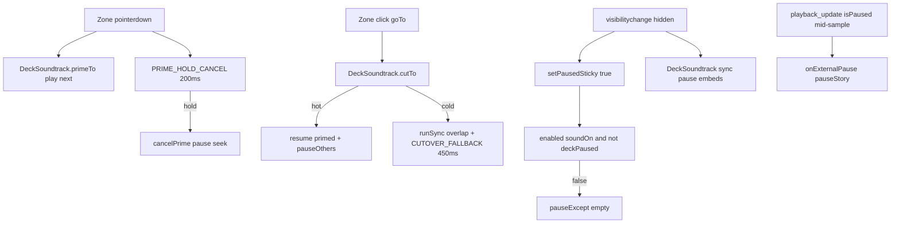

# Slice: Soundtrack / pause bugs

**Status:** Fixes shipped (2026-10-28). See [soundtrack-pause-bugs-fix.md](soundtrack-pause-bugs-fix.md).  
**Evidence:** `/Users/amatias/Downloads/recordingbugs.MP4` + `?debug=soundtrack` panel logs.  
**P2 note:** Control Center / tab hide sticky-pause is [D-031](../decisions/D-031-pause-on-tab-hide.md) by design (stay paused on return).

## What we proved

Recordingbugs symptoms mapped to `PRIME_HOLD_CANCEL_MS=200` wiping hot primes, priming `cutoverFallback` holes, and late play after hold-cancel. Fixes: 550ms hold cancel, `takeActOwnershipNow` / `priming-hot`, audible fallback `play()`, 700ms reject latch.

## Pain points (ranked)

### P1. Soundtrack dies while the story keeps “playing”

- **Symptom:** Digital silence for seconds while chrome still shows pause (`||`), progress fills, copy advances.
- **Recording example:** **5.0–10.4s** (~5.4s dead air) on Liked list after a ~0.9s chirp; subtitle lands mid-silence.
- **Why it hurts:** Story and audio desync; feels broken, not “paused.”

### P2. Unprompted sticky pause

- **Symptom:** Chrome flips to play (resume) and audio stops without a clear pause-button tap.
- **Recording examples:**
  - **~22.6s** after soft close → Liked restart (~1.2s silence; sticky vs cutover TBD).
  - **~37.6–40.7s** on “36 all time favs got ghosted” (~3.2s silence + play icon); Control Center / system sheet visible mid 28–42s window.
- **Why it hurts:** User must tap play to continue; feels like the app paused them.

### P3. Long press plays / bleeds the next song

- **Symptom:** Holding on a story tap zone makes the next act’s sample audible under (or instead of) the current one; short chirps on advance.
- **Recording examples:** **4.1–5.0s** (~0.9s), **10.4–11.0s** (~0.6s) chirp-then-silence; AssistiveTouch menu ~30s proves holds occurred.
- **Why it hurts:** Known scar still reproducing; undermines “hold cancels prime only.” See [SCARS.md](../../SCARS.md) “Hold on story screen plays the next song under the current one.”

### P4. ~1s blackout gaps on act transitions

- **Symptom:** Repeatable ~1.1–1.2s silence at slide / act cuts even when recovery works.
- **Recording examples:** 16.9–18.1s (into soft close), 22.6–23.7s, 11.0–12.1s after chirp.
- **Why it hurts:** Cuts feel glitchy; compounds P1 when recovery fails.

### P5. Soft-close → restart handoff roughness

- **Symptom:** Jump from soft close back to Liked (~21s) with messy audio/pause around the cut.
- **Note:** May be intentional Replay; still a stress case for `cutTo` + sticky clear.

## What success means (later fix slice)

1. **Continuous solo soundtrack:** While chrome shows pause (`||`) and sound is on, there is always one intentional act audible. No multi-second digital silence mid-slide unless Spotify itself is unreachable (then show a recoverable state, not fake “playing”).
2. **Sticky pause is intentional only:** Pause icon flips to play only from: pause chrome, Space, real media-key pause, or true tab/app hide (`document.hidden`). Control Center / AssistiveTouch during an active Safari tab must not sticky-pause unless the tab actually hides (if iOS hides, staying paused per [D-031](../decisions/D-031-pause-on-tab-hide.md) is correct; document that).
3. **Long press does not audition the next song:** Hold ≥ ~200ms on left/right zones cancels any speculative prime with no audible next-act bleed lasting beyond a negligible chirp (< ~150ms). Hold must not advance the slide unless a real tap/click commits.
4. **Act cuts:** Tap-advanced cuts with a hot prime resume without a ~1s hole. Cold cuts may soft-crossfade/overlap briefly; never pause-both then wait.
5. **Regression:** Existing scars stay honored: no zone hold-pause; tab hide still sync-pauses embeds ([SCARS.md](../../SCARS.md), D-031).

## Architecture

Key files:

- [ApiScrappedDeck.tsx](../../src/components/scrapped/ApiScrappedDeck.tsx): zones, `PRIME_HOLD_CANCEL_MS=200`, sticky pause, `visibilitychange`
- [ScrappedExperience.tsx](../../src/components/scrapped/ScrappedExperience.tsx): `enabled={soundOn && (!started || !deckPaused)}`, prime/cut bridges, `onExternalPause/Resume`
- [DeckSoundtrack.tsx](../../src/components/scrapped/DeckSoundtrack.tsx): `primeTo` / `cancelPrime` / `cutTo` / cutover fallback / loop A/B / external pause / hide latch
- Debug helper: [soundtrackDebug.ts](../../src/lib/soundtrackDebug.ts) (`?debug=soundtrack`)

## Debug logging (loop focus)

Append `?debug=soundtrack` on `/` (canonical story). `/scrapped?debug=soundtrack` redirects to `/?debug=soundtrack`. Logs go to the console as `[scrapped:soundtrack] <ms> <event> {…}`.

Helper: [src/lib/soundtrackDebug.ts](../../src/lib/soundtrackDebug.ts). Wired (log-only) in [DeckSoundtrack.tsx](../../src/components/scrapped/DeckSoundtrack.tsx). On-device HUD: [SoundtrackDebugPanel.tsx](../../src/components/scrapped/SoundtrackDebugPanel.tsx) (cases **E First loop** / **F Second loop**).

Loop events: `playback.nearEnd`, `loop.schedule`, `beginLoopCutover` (+ `.skip`), `tryLoopCutover` (+ `.timer` / `.timerSkip`), `fallbackLoopRestart`, `loop.pausedAtEnd`, `ensureTwinUri`. Snapshot fields include `playSlot`, `incomingLoop`, `twinReady`, `healthy`, `coolMs`, `pos` / `dur` / `rem`.

**No control-flow changes**; logging only. Panel Copy dumps the ring buffer.

## iOS Safari / stay-put repro protocol

Full runbook + paste template: [soundtrack-pause-bugs-repro.md](soundtrack-pause-bugs-repro.md).

**Focus (2026-10-28):** Same-URI loop death (H-a2). Stay on one act past preview end; do not tap. Desktop often survives one loop and dies on the second.

## Preliminary hypotheses

### Silence while “playing” (P1)

| ID | Hypothesis | Code anchor | Falsify if | Status |
|----|------------|-------------|------------|--------|
| H-a1 | `scheduleCutoverFallback` (450ms) commits ownership and pauses the old act before the new embed is audible | `scheduleCutoverFallback` | During gap, old act still reports playing until new RMS rises | **Confirmed** (log fires; see table) |
| H-a2 | Same-URI loop cutover fails; both slots end paused with `enabled=true` | loop cutover path | Gap not near preview end; twin still advancing | **Confirmed + fixed** (hot `resume()` after first loop; stall armed ~1.8s early) |
| H-a3 | `cutTo` hot `resume()` no-op after `tryFinishPrime` seek+pause | `cutTo` hot path; `tryFinishPrime` | After cut, owning embed `isPaused:false` with continuous RMS | **Open** (hot path works when prime survives) |
| H-hold200 | `PRIME_HOLD_CANCEL_MS=200` cancels a hot prime on normal slow taps (>200ms press), forcing `cutTo path=cold` | `ApiScrappedDeck` zone hold timer | Normal taps consistently `cutTo path=hot` | **Confirmed** |

### Chirp then silence (P1 / P3 / P4)

| ID | Hypothesis | Code anchor | Falsify if | Status |
|----|------------|-------------|------------|--------|
| H-b1 | `primeTo` chirps; park; `cutTo` `resume()` fails → hole | `primeTo`; cutTo hot | Hot resume continuous | **Open** (hot path looked healthy when used) |
| H-b2 | Click while still priming → incoming + 450ms fallback | cutTo priming branch | Never see `path=priming` + `cutoverFallback` | **Confirmed** |

### ~1.2s blackouts (P4)

| ID | Hypothesis | Code anchor | Falsify if | Status |
|----|------------|-------------|------------|--------|
| H-c1 | Forced cut at 450ms + Spotify buffer ≈ mute gap | `CUTOVER_FALLBACK_MS` | Hot-resume taps still show 1.2s hole | **Confirmed** (fallback event) |
| H-c2 | Autoplay advances without `primeTo` → always cold `runSync` | uri debounce; autoplay | Same gaps only on primed taps | **Open** (Case A not hands-off in logs) |

### Long-press next song (P3)

| ID | Hypothesis | Code anchor | Falsify if | Status |
|----|------------|-------------|------------|--------|
| H-d1 | Late `play()` after `cancelPrime` (200ms); finish fallback no-ops | `cancelPrime` | After 200ms hold, next iframe never audible | **Partial** (cancel fires; bleed not proven in logs) |
| H-d2 | Finish-fallback races cancel; unfinished prime bleeds | prime finish fallback | Holds >450ms always leave next paused | **Open** |
| H-d3 | Long-press still fires `click` → `goTo`/`cutTo` | zone click → goTo | `active` unchanged during bleed | **Open** |

### Unprompted sticky pause (P2)

| ID | Hypothesis | Code anchor | Falsify if | Status |
|----|------------|-------------|------------|--------|
| H-p1 | `document.hidden` from Control Center / app switch / recording UI → D-031 sticky | deck + soundtrack hide handlers | No `visibilitychange`; chrome stays `\|\|` | **Untested** in panel runs (Case C used pause button) |
| H-p2 | Mid-sample Spotify `isPaused` → `notifyExternalPause` → sticky | playback_update paused path | No `onExternalPause`; only cutover silence with `\|\|` | **Confirmed + fixed** (stale pause after hot cutTo / back-nav) |
| H-p3 | Accidental pause chrome / Space | `togglePaused` | No pointer/key near chrome | **Recording unlikely**; panel Case C was intentional toggle |

## Confirmed / Falsified

**Legend:** Confirmed = runtime logs from `?debug=soundtrack` panel (2026-10-28).

| ID | Result | Proof |
|----|--------|-------|
| H-hold200 | **Confirmed** | Repeated: `zonePointerDown` → `tryFinishPrime` → ~200ms `primeHoldCancel` + `cancelPrime` (clears `hotPrimed`) → later `zoneClick` → `cutTo path=cold`. Fast taps (&lt;200ms) get `path=hot` or `path=priming`. This is the main tap-advance regression. |
| H-b2 | **Confirmed** | `cutTo path=priming` then `cutoverFallback … ms=450 entryReady=true entryAudible=true` (~40s in second paste). |
| H-a1 / H-c1 | **Confirmed** | Same `cutoverFallback` event; matches recording ~1s blackout class. |
| H-a3 / H-b1 | Not shown | When prime survived, `cutTo path=hot` completed with `tryCutover` / ownership flip; no silence signature in those lines. |
| H-c2 | Not shown | After Clear, first events were taps; no pure autoplay stretch. |
| H-p1 | Not shown | No `visibilitychange` lines; Case C logged `sticky source=togglePaused` only. |
| H-d1 | Partial | Hold cancel path works as designed; audio bleed not captured (logs cannot hear). |

## Fix target rank (shipped)

1. **H-hold200:** `PRIME_HOLD_CANCEL_MS` 200 → 550.  
2. **H-b2 / H-a1 / H-c1:** `priming-hot` ownership + fallback `play()` when audible; hot cut uses `play()`.  
3. **H-d1:** 700ms reject latch after `cancelPrime`.  
4. **H-p1:** Documented as D-031 (no auto-resume).

See [soundtrack-pause-bugs-fix.md](soundtrack-pause-bugs-fix.md).
